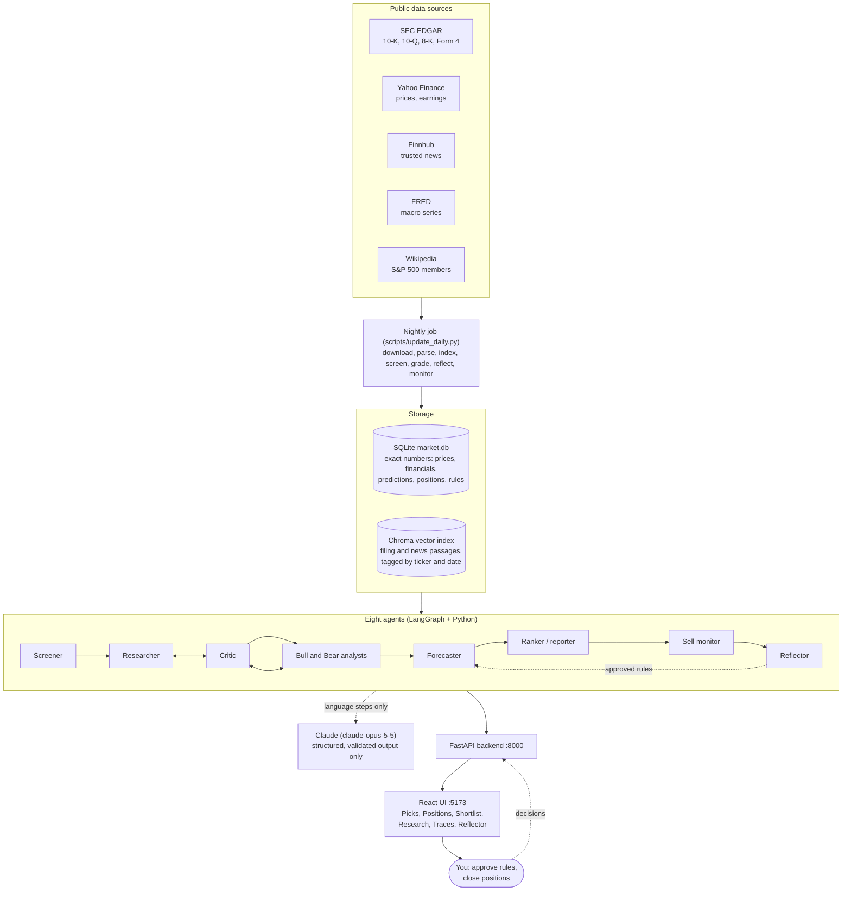
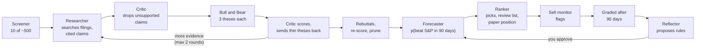

# Stock Research Agent

An autonomous, multi-agent system that screens the S&P 500 every night, researches the most promising stocks from their
SEC filings with cited evidence, debates the bull and bear case, and estimates the probability that each stock beats the
S&P 500 over the next 90 days. It then watches the positions it would have taken, grades its own forecasts, and proposes
corrections to itself, with a human approving every change that matters.

> **Decision support only, not financial advice. Paper trading only.** The system never places a trade.

Capstone project for the CMU agentic AI program (Forecaster track). Built with LangGraph, Claude, Chroma, SQLite,
FastAPI and React.

**Start here:** this README explains what the system is and how to run it. To learn how to *use* the app screen by screen,
read the [User Manual](docs/USER_MANUAL.md).

---

## Contents

1. [The problem and the user](#1-the-problem-and-the-user)
2. [What the system does](#2-what-the-system-does)
3. [Architecture](#3-architecture)
4. [The eight agents](#4-the-eight-agents)
5. [Key design decisions](#5-key-design-decisions)
6. [Safety, reliability and human oversight](#6-safety-reliability-and-human-oversight)
7. [Evaluation and results](#7-evaluation-and-results)
8. [Repository layout](#8-repository-layout)
9. [Setup and running](#9-setup-and-running)
10. [Reviewing the project without running it](#10-reviewing-the-project-without-running-it)
11. [Limitations and next steps](#11-limitations-and-next-steps)
12. [Further reading](#12-further-reading)

---

## 1. The problem and the user

**User:** an individual investor who manages their own portfolio and wants to make better-informed decisions, but has
no analyst team.

**Problem:** about 500 companies, each filing 10-Ks, 10-Qs and 8-Ks, plus prices, insider trades, macro data and news.
A person cannot read it all, and a general chatbot asked "should I buy X?" answers from stale memory, mixes up
companies, invents numbers and sounds confident regardless. The investor needs a system that:

- narrows 500 stocks to a short list worth a look, every day;
- answers questions **only from the actual filings**, with a citation for every claim;
- gives a **calibrated probability** instead of a confident opinion, and says so when it doesn't know;
- keeps watching after a decision and flags when the reason for holding a stock has changed;
- **learns from its own mistakes** without changing itself unsupervised.

## 2. What the system does

| When | What happens | Who acts |
|---|---|---|
| Every night, 11:55 PM | Downloads new filings, prices, insider trades (Form 4), macro data (FRED) and trusted news; indexes new text; screens all ~500 S&P 500 stocks; prepares filings for the top new names; grades forecasts whose 90 days are up; runs the Reflector; runs the sell monitor's checks | Scheduled job, no LLM credit used |
| On demand: **Run today's picks** | For the top 5 shortlisted stocks: research, bull/bear debate, forecast, ranking; opens a paper position when the forecast clears the bar | Agents (uses Claude) |
| On demand: **Research** a question | Cited, verified answer from one company's filings, then an optional debate and forecast | Agents (uses Claude) |
| On demand: **Review open positions** | Re-checks each holding's original thesis against filings it has not seen | Sell monitor (uses Claude) |
| Anytime | Close a position, approve or retire a correction rule | **You** (never automatic) |

Every run is saved and can be replayed step by step in the **Traces** tab: which agent did what, what it searched,
what it kept or rejected and why, and how the final probability was computed.

## 3. Architecture



**Why two stores:** exact numbers (prices, EPS, ratios) live in SQLite and are always computed by code, never by the
model. Text evidence (filing and news passages) lives in Chroma, where the Researcher searches it. Every query to either
store takes an **as-of date** and uses only information public on or before it, so backtests have no look-ahead.

### The life of one pick



## 4. The eight agents

The LLM is used only where a step needs judgment on text. Ranking, arithmetic, screening and learning are plain code,
so they cannot invent anything.

| Agent | Job | LLM? | Main safeguard | Code |
|---|---|---|---|---|
| **Screener** | Scores every S&P 500 stock on 6-month return vs the S&P 500, earnings yield and the latest EPS surprise (average percentile); shortlists the top 10 plus stocks with an unusual price move or earnings surprise | No | Deterministic; new listings with too little history go to human review | `stockagent/screener.py` |
| **Researcher** | LangGraph loop: plan searches, retrieve, judge whether the evidence is enough (search again if not), answer as separate claims, each citing evidence IDs (E1, E2…) | Yes | Every search filtered by ticker and as-of date; step budgets | `stockagent/research_graph.py`, `retriever.py` |
| **Critic** | Code checks first (cited IDs exist, right company, right date, every number appears in the cited text), then a separate LLM call judges each claim against only its cited text; in the debate it scores theses and can send a thin one back for more evidence | Yes + code | Unsupported claims are removed, not softened; revision and send-back loops are capped | `research_graph.py`, `debate_graph.py` |
| **Bull and Bear analysts** | Each writes 3 theses for the next 90 days from the same evidence, in parallel; each survivor then faces the other side's strongest rebuttal | Yes | Neither sees the other's drafts; best bull and best bear always survive pruning | `stockagent/debate_graph.py` |
| **Forecaster** | Calibrated price model (`p_quant`) + capped debate adjustment × shrink weight + human-approved correction rules = `p_final` | Model + debate | Adjustment capped at ±15 points and counted at half weight until live results prove it | `forecast_model.py`, `forecaster.py` |
| **Ranker / reporter** | Runs research → debate → forecast on the top 5 shortlisted stocks; ranks them; sends forecasts outside 35–65% to a human-review section; opens a paper position when `p_final` is above both 50% and the price model | No | Report assembled from verified theses only, no new LLM text | `stockagent/ranker.py` |
| **Sell monitor** | Flags open positions: trailing the S&P by 10+ points, 90 days reached, new filing; on request, re-checks the entry thesis against filings the pick never saw (intact / weakened / broken) | Code + LLM | Only flags; a verdict citing no new passage is rejected; closing is your decision | `stockagent/sell_monitor.py` |
| **Reflector** | Grades past forecasts, finds groups where they are consistently too high or low, proposes a correction, keeps it only if it improves accuracy on later data it never saw | No | Rules capped at ±5 points and inactive until you approve; active rules re-tested nightly | `stockagent/reflector.py` |

### How the Screener picks stocks: data sources

The Screener ranks stocks on **numbers only**; it never reads filing text. Numbers are cheap to fetch for all ~500
companies every night, while indexing a company's filing text takes minutes on a CPU, so filings are prepared only for
stocks the Screener has already shortlisted.

| Data | Source | Used for |
|---|---|---|
| S&P 500 member list (ticker, name, GICS sector, CIK) | Wikipedia's "List of S&P 500 companies", refreshed nightly | The universe to scan |
| Daily adjusted prices and volume, all members + SPY | Yahoo Finance via `yfinance` | **Momentum** (6-month return minus SPY's); **triggers** (5-day move above 2.5× normal volatility, 5-day volume above 3× normal); history check (new listings go to human review) |
| Annual diluted EPS | SEC EDGAR **XBRL company facts API** (structured numbers tagged in filings, with their filing date) | **Earnings yield** = EPS ÷ price (1 / P/E) |
| EPS estimate vs reported EPS | Yahoo Finance earnings dates | **Earnings surprise** (ignored if older than 120 days or beyond ±50%); a 10%+ surprise in the last 10 days is a trigger |

**Score** = the average of the three signals' percentile ranks among the ~50–70 candidates (equal weights; at least two
signals needed). The **shortlist** is the top 10 by score plus every triggered stock, except new listings, which go to
human review. Code: `stockagent/screener.py`, `scripts/08_screen.py`.

### How the Researcher retrieves evidence (RAG)

| Stage | What happens | Settings (`config.py`) |
|---|---|---|
| Indexing (nightly) | 10-K, 10-Q and 8-K sections plus trusted news are split into chunks that never cross a section, each prefixed with "TICKER FORM filed DATE, section" | ~600 tokens (`CHUNK_CHARS` 2,400), 300-character overlap |
| Embedding and store | Chunks embedded locally with **bge-m3** (via Ollama) and stored in a **Chroma** vector database (cosine distance); about 6,964 passages today | `EMBED_MODEL`, `CHROMA_COLLECTION` |
| 1. Filter | Only the selected ticker, filed on or before the as-of date | always on |
| 2. Hybrid candidates | **Semantic:** nearest passages by vector similarity · **Keyword (BM25):** exact terms such as "Item 5.02" · **Newest filings:** nearest passages from the latest 10-Q/10-K and earnings release | top 30 (`RETRIEVE_FETCH_K`), top 10 (`RETRIEVE_KEYWORD_K`), top 8 (`RETRIEVE_LATEST_K`): about 30–48 unique candidates |
| 3. Rerank | Local cross-encoder **ms-marco-MiniLM-L-12-v2** (ONNX, via fastembed) scores every candidate; minus 2 points per year of filing age | `RERANKER_MODEL`, `RECENCY_PENALTY_PER_YEAR` 2.0 |
| 4. Drop | Cosine distance over 0.55; near-duplicates (80% contained in a kept passage); more than 2 news items | `MAX_COSINE_DISTANCE`, `NEAR_DUPLICATE_CONTAINMENT`, `NEWS_MAX_PER_QUERY` |
| 5. Keep | The best 5 go to the Researcher, each with an evidence ID it must cite | `RETRIEVE_FINAL_K` 5 |

The Researcher runs up to 3 retrieval rounds per question, and the debate's send-backs use the same retriever. Every
search, with every candidate's scores and why it was kept or dropped, is logged to `logs/retrieval_trace.jsonl` and shown
in the Traces tab. Code: `stockagent/retriever.py`, `scripts/03_ingest.py`.

How the debate works in detail (scores, pruning, "contested"): see the docstring at the top of
`stockagent/debate_graph.py`. How the forecast is built: the docstring of `stockagent/forecaster.py`.

## 5. Key design decisions

| Decision | Why |
|---|---|
| **Claims, not prose.** The Researcher answers as a list of atomic claims, each citing evidence IDs; the report is assembled from verified claims only | A free-form summary is where unverified text slips in. Atomic claims can each be checked |
| **Checks in code before the critic** (IDs, ticker, date, numbers) | Cheap, deterministic, and they catch the most common failures (wrong company, future filing, invented figure) |
| **Ticker and as-of filters on every search** | In the failure demo, an unfiltered "cloud revenue" query for Apple returned 5 of 5 Microsoft passages; filtered, 5 of 5 Apple |
| **Reranker + recency + keyword search** | Vector similarity has no notion of "latest quarter". A cross-encoder reranker, a recency penalty and BM25 candidates raised "right passage first" from 0.44 to 0.72 on the test set |
| **Tree-of-Thought only in the thesis stage** (bull/bear debate as a beam search) | Branching where competing explanations really exist; everything else stays a simple pipeline |
| **Probability from a calibrated model, judgment as a small capped nudge** | Price signals carry little skill (it is hard to beat the market); the LLM's judgment counts for less until live results show it helps |
| **Learning without an LLM, approval by a human** | The Reflector can only report patterns that really exist in the outcomes; a person decides whether a short-term pattern deserves to change behavior |
| **Fail closed** | Weak evidence or a failed model call returns "insufficient evidence", never a guess |
| **Two stores, numbers in code** | The model never does arithmetic; every figure shown is computed from the database |
| **Claude through structured output** | Every LLM call returns a validated Pydantic object, so a malformed answer cannot pass as evidence |
| **SQLite, Chroma, local embeddings (bge-m3 via Ollama)** | Single user, nightly batch writes, zero setup, everything rebuildable from public data |
| **React + FastAPI** | A real UI over the same Python code the scheduled job uses |

The full story of how the design evolved, checkpoint by checkpoint, is in [PROGRESS.md](PROGRESS.md) and the
checkpoint write-ups in [docs/](docs/).

## 6. Safety, reliability and human oversight

- **Grounding:** every claim cites evidence; code verifies IDs, company, date and every number; a separate critic judges
  support; unsupported claims are removed and listed as "Removed by verification".
- **No look-ahead:** every tool and search takes an as-of date; SEC data keeps its `filed` date; monthly macro figures
  wait for their publication lag.
- **Injection resistance:** retrieved text is treated as data; prompts tell the model to ignore instructions inside it.
- **Bounded loops and cost:** 3 retrieval rounds, 1 revision, 2 send-back rounds, a LangGraph recursion limit; daily runs
  cover 5 stocks (about 12–15 LLM calls each) and start only when you press the button.
- **Calibration over confidence:** probabilities come from a calibrated model and are graded with the Brier score;
  evidence strength is computed from verification results, never self-reported by the model.
- **Human decisions:** closing positions and approving, rejecting or retiring rules are buttons, never automatic.
  Forecasts outside 35–65%, contested debates and new listings are flagged for review.
- **Reliability:** a pipeline lock lets only one process write to the index; each nightly step is incremental and
  optional sources (news, Form 4, FRED) can fail without stopping the run.
- **Observability:** every research and debate run saves a full JSON trace (`logs/runs/`), every search logs all
  candidates with scores and drop reasons (`logs/retrieval_trace.jsonl`), and the Traces tab replays them.

## 7. Evaluation and results

All results below come from real runs; the raw outputs are in [examples/](examples/).

| What was tested | How | Result |
|---|---|---|
| **Retrieval quality** | 18 hand-built questions over 11 companies, each with rule-defined answering passages (`eval/retrieval_cases.json`, `scripts/14_eval_retrieval.py`) | hit@5 **0.94**, MRR **0.80**, right passage first **0.72** (vector order alone: 0.89 / 0.59 / 0.44) |
| **Boilerplate** | Same 18 questions | Repeated passages in the top 5: **12 of 90 slots → 0** |
| **Wrong-company and look-ahead failures** | `scripts/06_failure_demo.py` | Unfiltered: 5/5 wrong-company results, 3/5 unusable (future or wrong company). Filtered: **0 wrong, 0 future** |
| **With vs without retrieval** | `scripts/05_compare.py`, Apple Services question | Without: stale figures from memory, confidence 25%. With: current-quarter figures from the 10-Q, checked against the filing |
| **Grounding in real runs** | Critic verdicts across daily runs | e.g. BBY: 25 claims, 0 rejected; PSX and DLTR each had 1 claim removed; a nonsense question ("India vs New Zealand score" on AMZN) returned *insufficient evidence* instead of an answer |
| **Forecast calibration** | Walk-forward backtest, yearly refit, 2018–2026, 44,660 out-of-sample forecasts | Brier **0.2487** vs 0.2493 (base rate) vs 0.2500 (always 50%): a small edge. Ranking AUC 0.52; top fifth beat the S&P 50.7% of the time vs 46.2% for the bottom fifth |
| **Self-correction** | Reflector on the backtest | Rules learned on 16 months; 2 of 3 failed the 8.5-year re-test and were retired by the user; Real Estate (−5) kept because it helps in the recent high-rate period |
| **Unit tests** | `pytest` | **53 pass**: as-of logic, screener, forecaster, debate checks and scoring, send-back, novelty, reflector out-of-sample rejection, retriever recency and keyword search, sell monitor, sources |

**Honest reading:** the system is good at *grounded research* (it rarely states what the filings don't say, and it
refuses when it can't answer) and *modest at prediction*, as expected: price signals barely beat the base rate. Live
forecasts started on 2026-11-17 and are first graded in mid-February 2027.

## 8. Repository layout

```
stock-research-agent/
├── README.md               this file
├── PROGRESS.md             running log: every step, decision and real result, in order
├── config.py               all settings: tickers, thresholds, budgets, model choice
├── .env.example            template for your local .env (SEC contact, API keys)
├── requirements.txt        Python dependencies
├── stockagent/             the system
│   ├── research_graph.py   Researcher + Critic (LangGraph)
│   ├── debate_graph.py     Bull, Bear + Critic, send-back to the Researcher (LangGraph)
│   ├── retriever.py        filtered vector + keyword search, reranker, recency, trace log
│   ├── forecast_model.py   calibrated logistic regression on price features
│   ├── forecaster.py       p_final = model + capped debate adjustment + approved rules
│   ├── screener.py         nightly S&P 500 screen
│   ├── ranker.py           daily picks run
│   ├── sell_monitor.py     paper positions, flags, thesis check
│   ├── reflector.py        grading, segment analysis, rule proposals
│   ├── market.py, features.py, context.py   as-of tools: prices, returns, Form 4, FRED
│   ├── llm.py              one structured-output call (Claude or local Ollama)
│   └── db.py, vectorstore.py, embeddings.py, loaders.py, sec.py, ondemand.py
├── api/main.py             FastAPI backend (every endpoint listed in its docstring)
├── web/                    React + TypeScript UI (Vite)
├── scripts/                numbered pipeline steps, nightly job, scheduler, evaluation scripts
├── tests/                  pytest suite (53 tests)
├── eval/                   retrieval test set
├── examples/               sample outputs: daily reports, run traces, evaluation results
└── docs/                   user manual, design handoff, checkpoint write-ups (Modules 1–6)
```

## 9. Setup and running

Tested on Windows 11 with Python 3.12 and Node 26. The scheduler script is Windows-only; everything else is portable.

### 9.1 Prerequisites

| Need | Why | Get it |
|---|---|---|
| Python 3.12 | Backend and agents | python.org |
| Node.js 20+ | Web UI | nodejs.org |
| Ollama with `bge-m3` | Local embeddings for indexing and search | ollama.com, then `ollama pull bge-m3` |
| Anthropic API key | Claude for the language steps | console.anthropic.com (or use local `qwen3:14b` via Ollama, much slower) |
| SEC contact string | SEC requires a name and email in every request | Your own name and email |
| Finnhub key (optional) | Trusted company news | finnhub.io (free); without it news is skipped |

### 9.2 Install

```powershell
git clone https://github.com/Ruthwik12/stock-research-agent.git
cd stock-research-agent
python -m venv .venv
.\.venv\Scripts\python -m pip install -r requirements.txt
copy .env.example .env          # then edit .env: SEC_USER_AGENT, ANTHROPIC_API_KEY, optional FINNHUB_API_KEY
cd web; npm install; cd ..
```

### 9.3 Build the data (first time only)

The repository does not include the data (about 1.3 GB). Build it from public sources, in this order, with Ollama
running. Indexing runs on the CPU and is the slow part: a full rebuild of about 5,500 passages took about 7 hours on a
laptop CPU; the 8 core companies alone take a few hours.

```powershell
.\.venv\Scripts\python scripts\01_download_filings.py   # SEC filings for the 8 core companies
.\.venv\Scripts\python scripts\02_parse_sections.py     # clean text by section
.\.venv\Scripts\python scripts\13_news.py               # optional: trusted news (needs FINNHUB_API_KEY)
.\.venv\Scripts\python scripts\03_ingest.py             # chunk, embed, index in Chroma (slow)
.\.venv\Scripts\python scripts\07_market_data.py        # prices, SEC financial facts, earnings for core companies
.\.venv\Scripts\python scripts\08_screen.py             # S&P 500 universe, prices since 2015, first screen
.\.venv\Scripts\python scripts\09_train_forecaster.py   # fit and calibrate the price model
.\.venv\Scripts\python scripts\10_backtest.py           # walk-forward backtest for the Reflector
.\.venv\Scripts\python scripts\11_insider_trades.py     # Form 4 insider trades
.\.venv\Scripts\python scripts\12_macro.py              # FRED macro series
```

Every step is incremental: re-running it only fetches what is new.

### 9.4 Run the app

Two terminals:

```powershell
# terminal 1: backend
.\.venv\Scripts\python -m uvicorn api.main:app --port 8000
```

```powershell
# terminal 2: UI
cd web; npm run dev
```

Open **http://localhost:5173**. Then follow the [User Manual](docs/USER_MANUAL.md).

### 9.5 Schedule the nightly job (Windows)

```powershell
powershell -ExecutionPolicy Bypass -File scripts\schedule_daily_update.ps1    # registers a daily 11:55 PM task
Start-ScheduledTask -TaskName StockAgent-DailyFilingsUpdate                    # run it now
```

Output goes to `logs/update_daily.log`. Don't use the app while the job runs (it holds the index lock), and don't run
`01`/`02`/`03`/`11`/`13` by hand at the same time.

### 9.6 Command-line tools

```powershell
.\.venv\Scripts\python scripts\run_research.py AAPL "What new risks did Apple highlight in its latest quarter?"
.\.venv\Scripts\python scripts\04_retrieve.py "services revenue growth" --ticker AAPL --as-of 2026-10-25
.\.venv\Scripts\python scripts\05_compare.py AAPL "<question>"      # with vs without retrieval
.\.venv\Scripts\python scripts\06_failure_demo.py                   # wrong-company and look-ahead demo
.\.venv\Scripts\python scripts\14_eval_retrieval.py                 # retrieval metrics on the test set
.\.venv\Scripts\python -m pytest -q                                 # unit tests (no network, no API key needed)
```

## 10. Reviewing the project without running it

Building the data takes hours, so the main outputs are included:

| Folder | What it shows |
|---|---|
| [examples/daily_reports/](examples/daily_reports/) | The three real daily picks reports (ranked picks, theses, risks, sources) |
| [examples/traces/](examples/traces/) | A full research trace, report and debate trace for Best Buy (BBY), and a fail-closed run (AMZN, off-topic question → insufficient evidence) |
| [examples/evaluation/](examples/evaluation/) | Retrieval metrics, the with-vs-without-retrieval comparison and the failure-mode demo |
| [PROGRESS.md](PROGRESS.md) | Every build step with its real result, bugs found and fixed, and decisions |
| [docs/](docs/) | Checkpoint write-ups (problem, reasoning and memory, RAG, Tree-of-Thought, multi-agent design, safety and evaluation) |

Good places to start in the code: `stockagent/research_graph.py` (the anti-hallucination guardrails are listed in its
docstring), `stockagent/debate_graph.py`, `stockagent/forecaster.py`, `stockagent/reflector.py`.

## 11. Limitations and next steps

**Limitations**

- **Prediction skill is small.** Brier 0.2487 vs 0.2493 for the base rate; the system is honest about it, but it is not
  a market-beating model.
- **Survivorship bias.** The backtest uses today's S&P 500 members; companies removed from the index are missing.
- **No live track record yet.** The first live forecasts (2026-11-17) are graded in mid-February 2027; the shrink weight
  on LLM judgment stays at 0.5 until then.
- **Reflector scope.** It learns only along fixed groupings (sector, momentum, volatility, debate lean, contested).
- **Retrieval test set is small** (18 questions, tuned on the same set).
- **Cost and latency** are not tracked per call; indexing new companies is slow on a CPU.
- **Single user, single machine.** SQLite and a Windows scheduled task.

**Next steps**

1. Add S&P 500 membership history to remove survivorship bias.
2. Grade live forecasts as they resolve and let the shrink weight move with real results.
3. Track tokens and cost per run; show them in the Traces tab.
4. Grow the retrieval test set from real failures, including exact-term questions.
5. Plain-language wording on the Reflector page for new users.
6. Move to PostgreSQL and a hosted scheduler for multiple users.

## 12. Further reading

- [docs/USER_MANUAL.md](docs/USER_MANUAL.md): how to use every screen
- [PROGRESS.md](PROGRESS.md): the build log with real results
- [docs/Stock_Agent_Capstone_Handoff.md](docs/Stock_Agent_Capstone_Handoff.md): the original design brief
- `docs/checkpoint*.md` and PDFs: write-ups for each program module

## License

[MIT](LICENSE). The software is provided as is; nothing in this repository is financial advice.
