# Stock Research Agent: User Manual

A step-by-step guide to using the app, with screenshots of every screen. For what the system is and how to install it,
see the [README](../README.md).

> **Decision support only, not financial advice. Paper trading only.** The app never buys or sells anything. A
> *paper position* is a simulated holding the system uses to track how its own picks perform.

---

## Contents

1. [Before you start](#1-before-you-start)
2. [Finding your way around](#2-finding-your-way-around)
3. [Shortlist: what the screener found tonight](#3-shortlist-what-the-screener-found-tonight)
4. [Research: ask a question about one company](#4-research-ask-a-question-about-one-company)
5. [Today's picks: the daily ranked list](#5-todays-picks-the-daily-ranked-list)
6. [Positions: what you hold and how it's doing](#6-positions-what-you-hold-and-how-its-doing)
7. [Traces: see exactly how a decision was made](#7-traces-see-exactly-how-a-decision-was-made)
8. [Reflector: how the system grades and corrects itself](#8-reflector-how-the-system-grades-and-corrects-itself)
9. [A typical day, step by step](#9-a-typical-day-step-by-step)
10. [What costs money and what is free](#10-what-costs-money-and-what-is-free)
11. [Glossary](#11-glossary)
12. [Troubleshooting and FAQ](#12-troubleshooting-and-faq)

---

## 1. Before you start

1. **The data must be built once.** The first time, run the pipeline in README section 9.3 (it downloads filings and
   prices and builds the search index; it takes a few hours). After that, the nightly job keeps it up to date.
2. **Ollama must be running** with the `bge-m3` model (it turns questions into search vectors).
3. **Start the app** (README section 9.4): the backend in one terminal, the UI in another. Then open
   **http://localhost:5173** in your browser.
4. **Avoid 11:55 PM to about 1:45 AM.** The nightly job is updating the data then and holds the search index;
   research may fail or be slow. Close the app before 11:55 PM.
5. **Know what costs money.** Four buttons call the Claude API and use credit: *Research*, *Debate and forecast*,
   *Run today's picks* and *Review open positions*. Everything else is free (section 10).

## 2. Finding your way around

Every screen has the same dark bar at the top:

- **The title and disclaimer** remind you that this is decision support with paper trading only.
- **Six tabs** follow the system's daily loop, left to right:

| Tab | The question it answers |
|---|---|
| **Today's picks** | Which stocks look best today, and why? |
| **Positions** | What am I holding (on paper), and is it beating the S&P 500? |
| **Shortlist** | Which stocks did the screener flag tonight? |
| **Research** | What do a company's own filings say about my question? |
| **Traces** | How exactly did the agents reach a given answer or pick? |
| **Reflector** | How accurate has the system been, and what corrections does it propose? |

- **The Positions tab carries two counters:** the grey number is how many positions are open, and the red
  "N flagged" badge is how many need your attention. If you see red, start there.
- **The browser address remembers the tab** (for example `#positions`), so refreshing the page keeps you where you
  were, and you can bookmark a tab.

## 3. Shortlist: what the screener found tonight

Every night the **Screener** scores all ~500 S&P 500 stocks and keeps the 10 best, plus any stock with a sudden
event. This tab shows that list. It is free to look at.

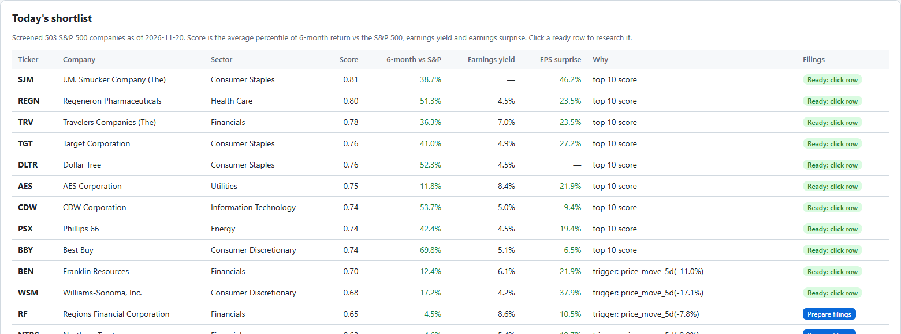

**How to read each column**

| Column | Meaning | In the example |
|---|---|---|
| Score | The average percentile of the three signals, from 0 to 1. Higher is better | SJM 0.81 is the top-scored stock |
| 6-month vs S&P | Price return over 6 months minus the S&P 500's (momentum). Green = ahead | BBY +69.8% |
| Earnings yield | Earnings divided by price. Higher means cheaper | RF 8.6% |
| EPS surprise | How much the last reported earnings beat (green) or missed analysts' estimates | WSM +37.9% |
| Why | "top 10 score", or a **trigger**: an unusual 5-day price move (`price_move_5d`) or a recent earnings surprise. In grey italics, "human review" means a new listing with too little history to score | BEN dropped 11% in 5 days |
| Filings | Whether the company's SEC filings are downloaded and indexed, so you can research it | Most say "Ready: click row" |

**What you can do here**

1. **Research a ready stock:** click anywhere on a row that says **Ready: click row**. The app switches to the
   Research tab with that company selected.
2. **Prepare a stock that isn't ready:** click **Prepare filings** (as on the RF row). The app downloads, parses and
   indexes that company's filings in the background; the badge reads "Preparing… (several minutes)". When it turns
   green, the stock can be researched. You can keep using the app meanwhile.
3. **If it says "failed, retry"**, click again; hovering shows the error.

The nightly job also prepares the top 3 new names automatically, so most of the list is usually ready.

## 4. Research: ask a question about one company

The **Researcher** answers your question using only the selected company's own filings (10-K, 10-Q, 8-K), its
insider trades (Form 4), macro data (FRED) and trusted news, all dated on or before today. A separate **Critic** then
checks every claim against its source and removes anything unsupported.

### 4.1 Ask a question

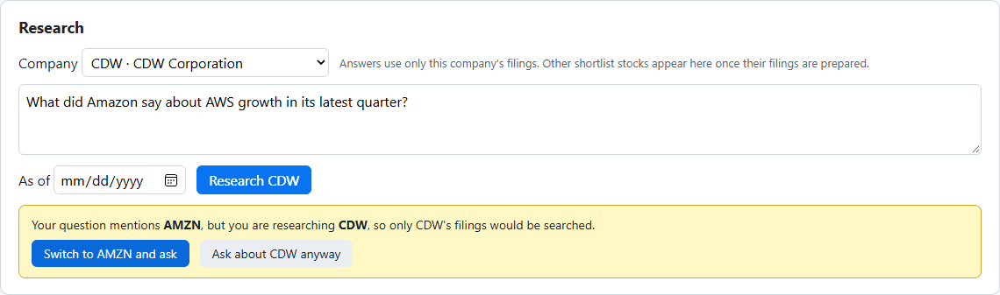

1. **Pick the company** in the **Company** dropdown. Only companies whose filings are ready are listed. (Clicking a row
   on the Shortlist tab or in the **Core companies** table below does the same.)
2. **Type a specific question.** Good questions name something a filing would contain:
   - "What drove revenue growth in the latest quarter, and what risks did management highlight?"
   - "Did the company raise or lower its full-year guidance?"
   - "What did the latest 8-K say about the CEO?"
   - "Have insiders been buying or selling shares recently?"
3. **Leave "As of" empty** to use today. Set a past date to see what the filings said back then (nothing filed after
   that date is used).
4. Click **Research {ticker}**. It takes about a minute and uses Claude credit.

**The wrong-company warning (shown above).** If your question names a different company than the one selected (here:
asking about Amazon while CDW is selected), a yellow box appears **before anything runs or costs money**:

- **Switch to AMZN and ask**: changes the company and runs your question there.
- **Ask about CDW anyway**: keeps CDW (useful if you really mean, say, "Does CDW sell to Amazon?").

This exists because the agents only ever search the selected company's filings; asking about another company would
just return "insufficient evidence".

### 4.2 Read the report

The report appears under the question box. Its parts:

| Part | What it tells you |
|---|---|
| **Evidence strength** | *strong / moderate / weak / insufficient*, computed from how many claims passed verification (not the model's own opinion) |
| **Claims** | Each statement ends with its evidence IDs, such as `[E3, E7]`. A grey note like *partially supported* means the critic found only part of it in the source |
| **Not covered by the evidence** | Parts of your question the filings didn't answer |
| **Risks the critic flagged** | Risks the critic thinks a careful answer should mention |
| **Removed by verification** | Claims the critic struck out, each with the reason. This is the system catching its own mistakes |
| **Sources** | Every evidence ID with a link to the SEC filing, so you can check it yourself |

**"Insufficient evidence"** is a deliberate answer, not a crash: the filings didn't support an answer, so the system
refused to guess. Try a narrower question about something a 10-K, 10-Q or 8-K would contain.

Under the report, **How this answer was built (trace)** opens the full step-by-step record in the Traces tab
(section 7).

### 4.3 Debate and forecast

After a report, click **Debate and forecast** (about a minute, uses Claude credit). Using the same evidence:

1. **Bull and Bear analysts** each write three theses about the next 90 days, without seeing each other's drafts.
2. **Code checks** reject theses that cite missing evidence or quote numbers not in the source.
3. **The Critic scores** each thesis from 0 to 10 and may **send a promising but thin thesis back** to the Researcher
   for one more search (at most two rounds).
4. Weak theses are **pruned**; each survivor faces **the other side's strongest rebuttal** and is re-scored.
5. **The Forecaster** turns the survivors into a probability.

The **forecast card** shows the arithmetic: the price model's starting probability, each debate adjustment with its
reason, any correction rule you approved, and the final probability of beating the S&P 500 over 90 days. The same
breakdown appears at the end of every trace (screenshot in section 7.4).

### 4.4 Core companies

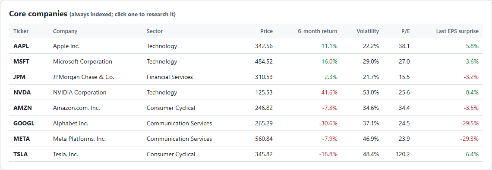

Eight large companies (Apple, Microsoft, JPMorgan, NVIDIA, Amazon, Alphabet, Meta, Tesla) are always indexed and
always researchable, whatever the screener picks. The table shows each one's latest price, 6-month return,
volatility, P/E ratio and last earnings surprise. Click a row to research it.

## 5. Today's picks: the daily ranked list

This tab runs the whole team on the best shortlisted stocks and ranks the results.

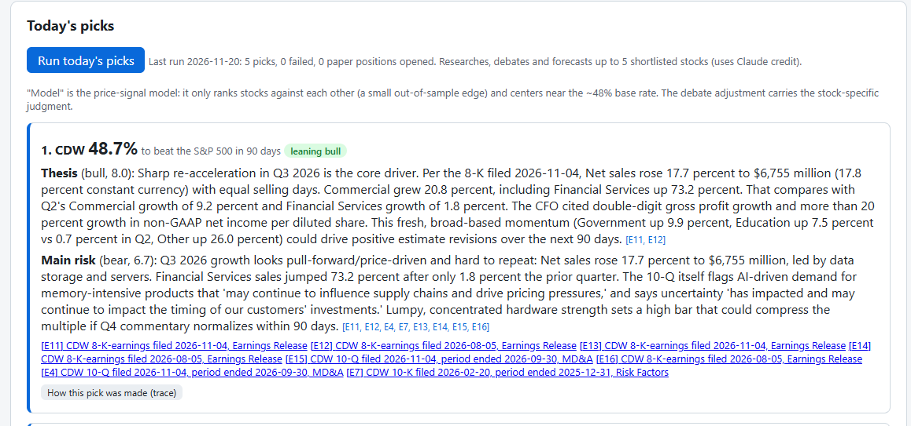

### 5.1 Run it

1. Click **Run today's picks**. For the top 5 shortlisted stocks with ready filings, it runs research, the bull/bear
   debate and the forecast, then ranks them.
2. It takes about 2–3 minutes per stock (10–15 minutes in all) and uses Claude credit. The page refreshes itself; you
   can use other tabs meanwhile.
3. The line next to the button summarizes the last run, for example "5 picks, 0 failed, 0 paper positions opened".

### 5.2 Read a pick card

Taking the first card above (CDW) from top to bottom:

| Part | Example | Meaning |
|---|---|---|
| Rank, ticker, probability | **1. CDW 48.7%** | The chance it beats the S&P 500 over the next 90 days. 50% is a coin flip; historically about 47% of S&P 500 stocks beat the index over 90 days |
| Badges | *leaning bull* | Which side won the debate. Other badges: *contested* (strong cases on both sides, so the adjustment is halved) and *outside 35–65%* (an unusually confident forecast, sent to human review) |
| **Thesis** | (bull, 8.0) "Sharp re-acceleration in Q3 2026…" | The strongest surviving argument on the winning side, its critic score, and its evidence IDs |
| **Main risk** | (bear, 6.7) "Q3 2026 growth looks pull-forward…" | The strongest argument on the other side. Read this before acting |
| Source links | [E11] CDW 8-K-earnings filed 2026-11-04… | Each cited filing, linked to SEC EDGAR |
| **How this pick was made (trace)** | | Opens this pick's full record in the Traces tab |

The note above the cards explains that "Model" is the price-signal model: it only ranks stocks against each other and
stays near the ~48% base rate, while the debate carries the stock-specific judgment.

### 5.3 Why no paper position opened

A paper position opens only when the probability is **above 50%** and **above the price model's own estimate** (so the
debate added an edge), and the system doesn't already hold that stock. In the run shown, every pick was below 50%, so
nothing opened: the system declined to act on a near coin flip. That is intended behaviour.

## 6. Positions: what you hold and how it's doing

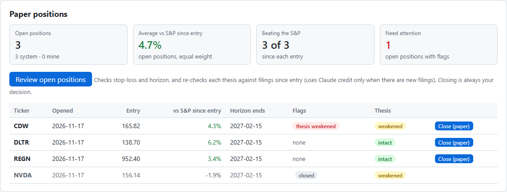

### 6.1 The summary tiles

| Tile | Example | Meaning |
|---|---|---|
| Open positions | 3 (3 system · 0 mine) | Open positions, split into those the system opened and those you added |
| Average vs S&P since entry | 4.7% | Average return of the open positions minus the S&P 500's over the same period (equal weight) |
| Beating the S&P | 3 of 3 | How many open positions are ahead of the index |
| Need attention | 1 | Open positions with at least one flag |

### 6.2 The table

Each row shows the ticker, the date it was opened, the entry price, the return versus the S&P 500 since entry (green =
ahead, red = behind), the date the 90-day horizon ends, flags, and the **thesis status**. Closed positions stay in the
list in grey (NVDA above).

**Flags** recommend a look; nothing happens automatically:

| Flag | Meaning | What to consider |
|---|---|---|
| trailing the S&P 500 by 10+ points | Stop-loss signal | Re-read the thesis; decide whether to close |
| 90 days reached: close and score | The forecast's horizon is over | Close it so it is scored |
| new filing since entry | Something new was filed | Click *Review open positions* |
| thesis weakened / broken | New information undermines the reason for holding | Read why (Review result); decide |

**Thesis status:** *intact* (green), *weakened* (yellow) or *broken* (red), from the last review. In the screenshot,
CDW is flagged *thesis weakened*.

### 6.3 Actions

1. **Review open positions** (uses Claude credit): for each position, the system collects filings the pick never saw
   (filed after entry, or filed before entry but not used by the pick, such as an 8-K about a CEO change) and asks
   whether they leave the original thesis intact, weakened or broken, citing the passage. If nothing new exists, no
   credit is used.
2. **Close (paper)**: asks you to confirm, then closes the position at the latest price and records its result. Only
   you can close a position; the system never does.

### 6.4 Add a stock you bought yourself

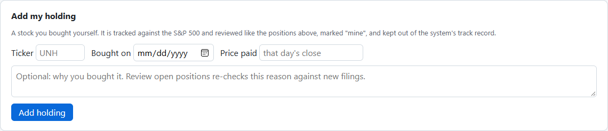

To track a stock **you** bought in a real account:

1. Enter the **Ticker** (S&P 500 stocks only, because it needs price data).
2. Enter the date in **Bought on**.
3. Enter the **Price paid**, or leave it empty to use that day's closing price.
4. Optionally write **why you bought it**. *Review open positions* will re-check this reason against new filings, as it
   does for the system's own theses.
5. Click **Add holding**.

It appears in the table with a *mine* badge, tracked against the S&P 500 and flagged like the others, but kept out of
the system's track record (the system didn't make that call).

## 7. Traces: see exactly how a decision was made

Every research run, from the Research tab or a picks run, is saved. This tab lets you replay any of them step by step:
which agent did what, what it searched, what it kept or threw away and why, and how the final number was computed.
It is free (it only reads saved files).

### 7.1 Pick a run

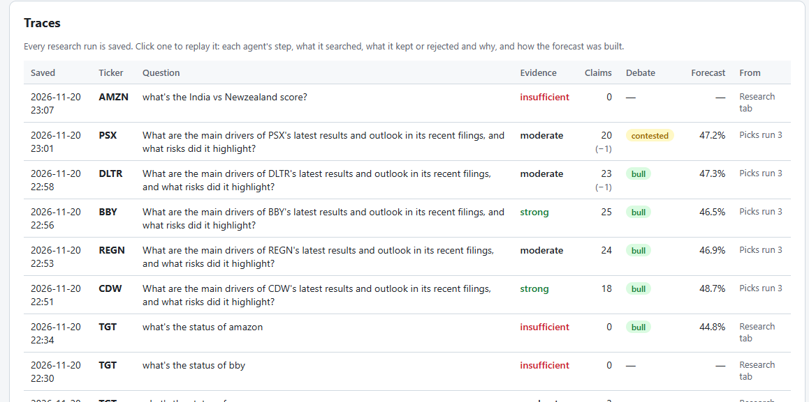

Each row: when it ran, the ticker, the question, the evidence strength, claims kept (and, in brackets, removed), the
debate's lean, the forecast, and where it came from (*Picks run 3* or *Research tab*). Note the first row: an
off-topic question ("India vs New Zealand score" on Amazon) correctly ended as *insufficient* with 0 claims.

Click a row to open its timeline below. The buttons **How this pick was made** and **How this answer was built** on
the other tabs open the right row directly.

### 7.2 The research steps

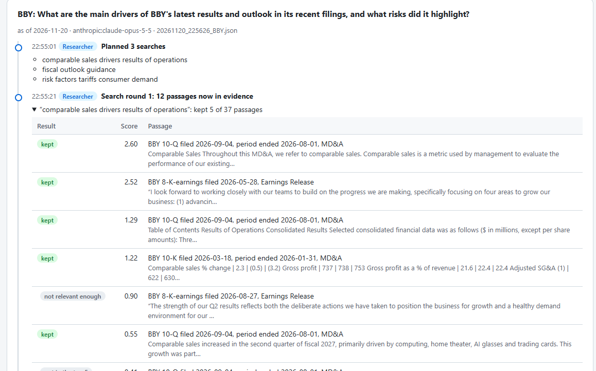

Each step shows the time, a coloured badge for the agent, and what it did:

1. **Researcher: Planned 3 searches.** The queries it decided to run.
2. **Researcher: Search round 1.** Click a search (▸) to open it. Every candidate passage is listed with its relevance
   score and the result: **kept**, or why it was dropped: *not relevant enough*, *not in the top 5*, *duplicate* or
   *news limit reached*.
3. **Researcher: Judged the evidence sufficient / not enough.** If something was missing, it says what and lists the
   follow-up searches, then runs round 2.
4. **Researcher: Drafted N claims**, each citing evidence (open *Draft claims* to read them).

Then the **Critic** checks every claim:

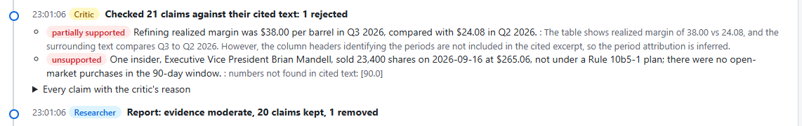

Claims the critic couldn't fully confirm are shown with the reason; open *Every claim with the critic's reason* for
the full list. The **Report** step summarizes how many claims were kept and removed.

### 7.3 The debate steps

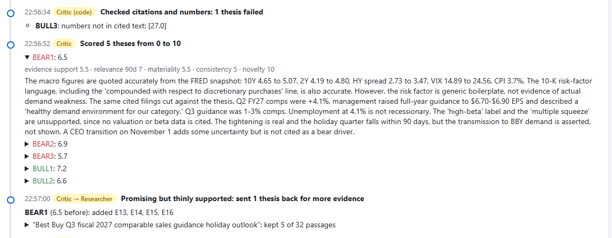

- **Bull analyst / Bear analyst:** each thesis with its evidence IDs.
- **Critic (code): Checked citations and numbers.** Theses that quote a number not in the cited text fail here
  (BULL3 above).
- **Critic: Scored N theses.** Open a thesis to see the parts of its score (evidence support, 90-day relevance,
  materiality, consistency, novelty) and the critic's full reasoning.
- **Critic → Researcher: sent back for more evidence.** The extra search it asked for and the passages it added.
- **Debate (code):** which theses survived and which were pruned; then **Bull and Bear** rebuttals (open each to read
  it), the **re-scores** after rebuttal, and the final lean.

### 7.4 The forecast

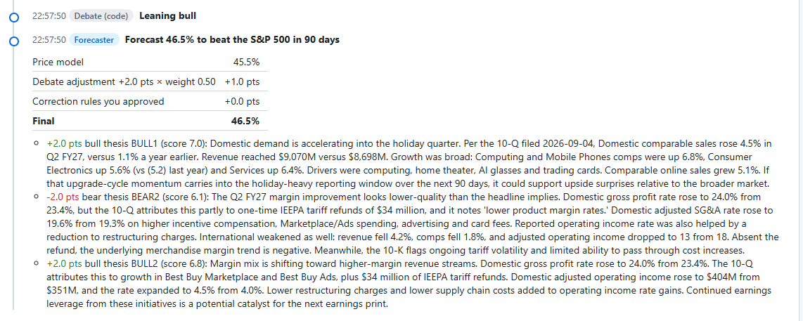

The last step shows the arithmetic:

- **Price model:** 45.5%.
- **Debate adjustment:** +2.0 pts × weight 0.50 = +1.0 pt. The weight stays at 0.5 until live results show the
  debate helps.
- **Correction rules you approved:** +0.0 pts.
- **Final:** 46.5%.

Below it, each adjustment's points and the thesis behind it. At the very bottom of the trace, **Evidence the agents
could cite** lists every passage with a link to its source.

## 8. Reflector: how the system grades and corrects itself

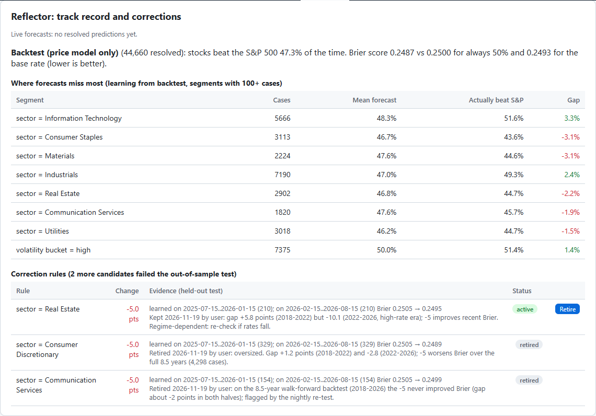

### 8.1 Track record

- **Live forecasts** are those made since the app went live. Each is graded once its 90 days pass, so the first grades
  arrive in mid-February 2027. Until then it says "no resolved predictions yet".
- **Backtest** replays the price model on 8.5 years of history (44,660 forecasts). Here stocks beat the S&P 500 47.3%
  of the time, and the **Brier score** was 0.2487, against 0.2500 for always saying 50% and 0.2493 for always saying
  the base rate. **Lower is better**, so the model has a small but real edge.

### 8.2 Where forecasts miss most

Groups of stocks where the average forecast differed from what actually happened. Read the **Gap** column as:

- **Positive (green): the system *underrates* the group.** Information Technology: forecast 48.3%, actually 51.6%, so
  it underrates tech by 3.3 points.
- **Negative (red): it *overrates* the group.** Consumer Staples: forecast 46.7%, actually 43.6%, so it overrates
  staples by 3.1 points.

### 8.3 Correction rules

Each night the Reflector turns large, consistent gaps into candidate rules (for example "Real Estate: −5 points"). A
rule is learned on older data and kept only if it makes forecasts more accurate on **later data it never saw**; the
title says how many candidates failed that test. A rule that passes is **proposed** and changes nothing until you act.

| Status | Meaning | Buttons |
|---|---|---|
| proposed | Passed the test on unseen data; waiting for you | **Approve** (starts adjusting forecasts) or **Reject** |
| active | Approved; adjusts future forecasts in that group | **Retire** if it stops helping |
| rejected / retired | Not in use | None |

The **Evidence** column shows the learning and test periods, the number of cases, and the accuracy before → after on
the test period. The second line is a note recording why the rule was kept or retired. If an active rule stops
helping, the nightly re-test adds the note "no longer improves recent Brier; consider retiring".

In the screenshot: Real Estate (−5) is **active** because it helps in today's high-interest-rate market; the other two
were **retired** after an 8.5-year check showed they didn't help.

## 9. A typical day, step by step

| When | Where | What to do |
|---|---|---|
| Morning | **Positions** | Red "flagged" badge? Read the flags. If a new filing arrived, click **Review open positions**. Close anything whose thesis is broken, if you agree |
| Morning | **Shortlist** | Scan tonight's list and triggers. Click a ready stock that interests you |
| Anytime | **Research** | Ask your questions. Read *Removed by verification* and the sources. Click **Debate and forecast** for a probability |
| When you want fresh picks | **Today's picks** | **Run today's picks**; read each card's thesis *and* main risk; open the trace for anything you'd act on |
| If you bought something | **Positions** | **Add my holding** with the reason you bought it |
| Weekly | **Reflector** | Approve or reject proposed rules; retire active rules flagged as no longer helping |
| Before 11:55 PM | | Close the app so the nightly job can update the data |

## 10. What costs money and what is free

| Uses Claude credit | Free |
|---|---|
| **Research** (about a minute) | Browsing every tab |
| **Debate and forecast** (about a minute) | Prepare filings |
| **Run today's picks** (about 12–15 calls per stock, 5 stocks) | Add my holding, Close (paper) |
| **Review open positions** (only when there are new filings) | Approve / Reject / Retire rules |
| | Traces, Reflector, the nightly job |

## 11. Glossary

| Term | Meaning |
|---|---|
| 10-K / 10-Q | Annual / quarterly report filed with the SEC |
| 8-K | Filing for a material event: an earnings release, a CEO change, an acquisition and so on |
| Form 4 | Filing that reports a company insider buying or selling shares |
| FRED | Federal Reserve economic data: interest rates, VIX, unemployment, inflation |
| MD&A | "Management's discussion and analysis": the part of a 10-K/10-Q where management explains results |
| As-of date | The date the analysis pretends it is; nothing published later is used |
| Evidence ID (E1, E2…) | A numbered passage the agents can cite |
| Thesis | An argument for (bull) or against (bear) the stock over the next 90 days |
| Contested | Best bull and best bear thesis both scored 7 or more; the adjustment is halved |
| p_quant / Price model | The statistical model's probability before any research |
| p_final | The final probability after the debate adjustment and approved rules |
| Base rate | How often S&P 500 stocks beat the index over 90 days historically (about 47%) |
| Brier score | Average squared error of probability forecasts; 0 is perfect, 0.25 is a coin flip |
| Paper position | A simulated holding used to track the system's picks; no money involved |
| Trace | The saved, step-by-step record of one run |

## 12. Troubleshooting and FAQ

| Problem | What to do |
|---|---|
| Page shows "Request failed" or nothing loads | Is the backend running on port 8000? Restart it (README 9.4) |
| Research is very slow or fails late at night | The nightly job is running (11:55 PM to about 1:45 AM). Try later |
| A company is missing from the Research dropdown | Its filings aren't ready: use **Prepare filings** on the Shortlist tab |
| "Insufficient evidence" | The filings don't answer the question; make it more specific to what filings contain |
| Error mentioning Claude or the LLM | Check `ANTHROPIC_API_KEY` in `.env` and your API credit |
| Search errors about embeddings | Start Ollama and make sure `bge-m3` is pulled |
| "Prepare filings" says failed | Click again; hovering shows the error (often a temporary SEC download problem) |
| A trace says it could not be displayed | The file is still in `logs/runs/`; report it as a bug |

**Does the app trade for me?** No. It never connects to a brokerage. Positions are simulated.

**Can I trust the probability?** Treat it as a calibrated estimate with a small edge over the base rate, not a
prediction. Read the thesis, the main risk and the trace, and decide yourself.

**Why are most probabilities between 44% and 52%?** Markets are hard to predict over 90 days. A calibrated model stays
near the base rate unless the evidence is strong; a system that showed 80% would be overconfident.

**Why did a claim I know is true get removed?** The critic removes anything the *cited passage* doesn't support, even
if it is true elsewhere. The trace shows the exact reason.
