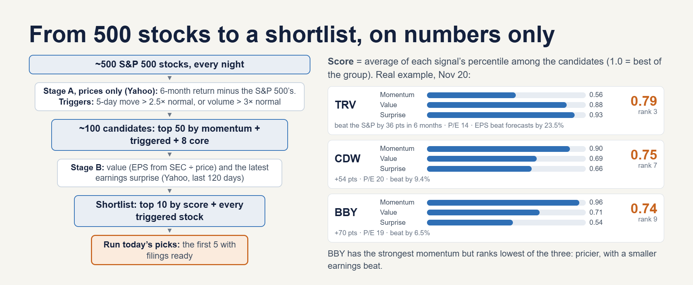

# Video script with live demo (about 9 minutes 55 seconds)

This is the slides script shortened to make room for a 3-minute app demo, which goes **between slides 9 and 10**.
The longer, slides-only version is in `Presentation_Script.md` and in the deck's speaker notes.
Pace: about 140 words per minute. **[click]** = advance the slide's animation.

| # | Part | Time | Cumulative |
|---|---|---|---|
| 1 | Cover | 0:15 | 0:15 |
| 2 | The problem and the user | 0:35 | 0:50 |
| 3 | Goal and scope | 0:30 | 1:20 |
| 4 | Architecture | 0:45 | 2:05 |
| 5 | The eight agents | 0:35 | 2:40 |
| 6 | The life of one pick | 0:45 | 3:25 |
| 7 | Key design decisions | 0:45 | 4:10 |
| 8 | Forecasting | 0:30 | 4:40 |
| 9 | Retrieval (RAG) | 0:40 | 5:20 |
| D | **App demo** | 3:05 | 8:25 |
| 10 | Evaluation and results | 0:40 | 9:05 |
| 11 | Safety and oversight | 0:20 | 9:25 |
| 12 | Repository and next steps | 0:30 | 9:55 |


---

## Part 1: Slides 1–9

### Slide 1. Cover (0:15)

Hi, I'm Ruthwik. This is my capstone, the Stock Research Agent: eight agents that research S&P 500 stocks from their
own SEC filings and estimate the chance each one beats the market over the next 90 days. It is decision support with
paper trading only. It never places a trade.

### Slide 2. The problem and the user (0:35)

The user is an individual investor managing their own money. Everything they need is public: about 500 companies,
each filing annual, quarterly and event reports, plus prices, insider trades, macro data and news. But they have no
analyst team to read it. And asking a chatbot is unsafe for money decisions: it answers from stale memory, mixes up
companies, invents numbers, and sounds just as sure when it's wrong. So they need a daily shortlist, answers cited to
the filings, an honest probability, and monitoring after they decide, with them in control.

### Slide 3. Goal and scope (0:30)

I framed the goal as a question I can grade: what is the probability this stock beats the S&P 500 over the next 90
days? Success means every claim cites a passage, with no wrong-company or future data; the right passage in the top
five for 90 percent of test questions; a Brier score below a coin flip and no worse than the base rate; "insufficient
evidence" instead of a guess; and a person taking every consequential action. It stays within the S&P 500, free
public data, and paper trading.

### Slide 4. Architecture (0:45, five clicks)

**[click]** The data comes from free public sources: SEC filings and insider trades, Yahoo Finance prices, Finnhub
news, FRED macro data, and the S&P 500 list from Wikipedia. **[click]** A nightly job downloads what's new, indexes the
text and screens all 500 stocks. **[click]** There are two stores on purpose: exact numbers in SQLite, computed only by
code, and filing passages in a Chroma vector database for retrieval. Every tool takes an as-of date, so nothing from
the future leaks in. **[click]** Then the eight agents; the orange ones call Claude, always through validated JSON.
**[click]** And a React UI puts the person at the end, where the decisions are.

### Slide 5. The eight agents (0:35)

Each agent has one job, and the key choice is where the language model is used. Screening, ranking, arithmetic and
learning are plain code, so they can't hallucinate; the screener uses only prices, volume, reported earnings and
earnings surprises. Claude is used only where text needs judgment: the researcher, the critic, the bull and bear
analysts, and the sell monitor's thesis check. The forecaster combines a calibrated statistical model with a small,
capped nudge from the debate.

### Slide 6. The life of one pick (0:45, four clicks)

**[click]** For one pick: the screener finds it, the researcher builds cited claims, the critic removes anything
unsupported, the bull and bear analysts write three theses each, and the forecaster turns the survivors into a
probability. **[click]** The debate is my Tree-of-Thought: weak theses are pruned, the best of each side is kept, and
promising but thin ones go back for more evidence, at most twice. **[click]** Above 50 percent, the ranker opens a
paper position; the sell monitor watches it, it's graded at 90 days, and the reflector looks for patterns in the
misses. **[click]** And a person approves every correction and closes every position.

### Slide 7. Key design decisions (0:45)

The design grew one layer per module: a gradable probability in module 1; the reasoning loop and memory in 2;
retrieval in 3, where an unfiltered Apple search returned five Microsoft passages, so filters became mandatory;
Tree-of-Thought only in the debate in 4; the agent team in 5; and guardrails and human triggers in 6. Building
corrected the design three times, shown in orange: the forecaster was retrained on ten years of data; reranking and
keyword search fixed "latest quarter" questions; and two learned rules failed a longer re-test and were retired.

### Slide 8. Forecasting (0:30)

The probability has three checked parts. First, a price model: a logistic regression on three price features, six- and one-month return against the S&P 500 and three-month volatility, calibrated and tested walk-forward on 44,660 forecasts. Prices carry little signal, so it stays near the 48 percent base rate: an honest anchor. Second, the debate nudge, capped at 15 points and half-weighted until live results prove it. Third, rules I've approved.

### Slide 9. Retrieval (RAG) (0:40)

Filings are split into chunks of about 600 tokens, embedded locally with the bge-m3 model, and stored in Chroma:
about seven thousand passages. Every search is first filtered to one company and to filings on or before the as-of
date. Then it is hybrid: the top 30 by meaning, the top 10 by keyword, and the 8 newest. A local cross-encoder
reranks them, preferring recent filings, drops weak matches and duplicates, and passes the best five to the
researcher, each with an ID it must cite. The right passage now comes first 72 percent of the time, up from 44. Let me show you the app.

---

## Part 2: App demo (3:05)

**Do** is what to click; **Say** is the narration. The numbers on your screen will differ from the examples here: read
what is shown.

### D1. The top bar (0:10)

**Do:** Switch to the browser, open on **Today's picks**.

**Say:** This is the app: a FastAPI backend and a React front end. The six tabs follow the daily loop, and the banner
reminds you it's decision support with paper trading only.

### D2. Shortlist (0:40)

**Do:** Click **Shortlist**. Point at the score column, then compare TRV, CDW and BBY (or any three rows near the top),
then a trigger, then the **Filings** column.

**Say:** Every night the screener ranks all 500 stocks on numbers only, no AI. First, prices: each stock's six-month
return minus the S&P 500's. The top 50 go on, plus any stock with a trigger: an unusual five-day move or a volume
spike. Then two more numbers: value, meaning earnings relative to price, and the latest earnings surprise. Each
becomes a percentile among the candidates, and the score is the average. So Best Buy has the best momentum here but
ranks below Travelers, which is cheaper and beat forecasts by more. The top ten by score, plus every triggered stock,
make the shortlist. "Ready" means its filings are indexed; "Prepare filings" downloads them on demand.

**Reference** (for you, not for the screen; Nov 20 values):



| Signal | What it measures | Source |
|---|---|---|
| Momentum | 6-month return minus the S&P 500's | Yahoo Finance prices |
| Value | Earnings ÷ price (the inverse of P/E); higher = cheaper | EPS from SEC filings |
| Earnings surprise | How much the last quarterly EPS beat or missed forecasts; ignored if older than 120 days | Yahoo Finance |
| Triggers | 5-day move above 2.5× normal, volume above 3× normal, or a 10%+ surprise in the last 10 days | Prices, volume, earnings |

Percentile: 1.0 = best among the ~100 candidates, 0 = worst. A stock needs at least two of the three signals to get a
score.

### D3. Research (0:45)

**Do:**
1. Click **Research** and select a ready company, for example **CDW**.
2. Type a question naming another company, such as *"What did Amazon report last quarter?"*. The yellow
   wrong-company warning appears. Don't click either button.
3. Replace the question with *"What drove revenue growth in the latest quarter, and what risks did management
   highlight?"* and click **Research**. **Cut the one-minute wait** in editing, or pause the recording.
4. Scroll the report: evidence strength, a claim with its `[E..]` IDs, **Removed by verification**, one source link.

**Say:** If my question names a different company, it stops before spending anything and asks which I meant, because
it only searches the selected company's filings. Now a real question. *(after the cut)* Evidence strength is computed
from how many claims passed verification. Every claim cites evidence that links to the SEC filing, and here is what
the critic removed, with the reason: the system catching its own mistakes.

### D4. Today's picks (0:35)

**Do:** Click **Today's picks**. Point at the first card: probability, badge, thesis, main risk, sources. Don't click
**Run today's picks** (it takes 10–15 minutes).

**Say:** Run today's picks takes the top five ready stocks through research, debate and forecast. It takes about
fifteen minutes, so this is the latest run. Each card shows the probability of beating the S&P 500 in 90 days, which
side won the debate, the strongest thesis, and the main risk from the other side, all with sources. *(If none is above
50%:)* None is above 50 percent, so no paper position opened: it declines to act on a coin flip. Positions that do open
appear on the Positions tab, where closing is a button only I press.

### D5. Traces (0:40)

**Do:** On the first card, click **How this pick was made (trace)**. Then:
1. Open one search (▸) to show kept and dropped passages.
2. Scroll to the critic's verdicts.
3. Scroll to the debate: a failed code check or a send-back, if this trace has one.
4. Stop on the forecast arithmetic at the end.

**Say:** The trace shows every step, by agent, in order. Opening a search shows every candidate passage, which were
kept, and why the others were dropped. Here are the critic's verdicts on each claim; in the debate, code rejects any
thesis that quotes a number not in its source. And at the end, the arithmetic: price model, plus the debate's nudge at
half weight, plus approved rules.

### D6. Reflector (0:15)

**Do:** Click **Reflector**. Point at the gaps table and the rules table.

**Say:** Finally, the Reflector: where forecasts miss most, and the correction rules it proposes. A rule must improve
accuracy on data it never saw, and does nothing until I approve it. Back to the slides.

---

## Part 3: Slides 10–12

### Slide 10. Evaluation and results (0:40)

On 18 hand-built questions, the right passage comes first 72 percent of the time. With filters, zero wrong-company
passages, against five of five without them. Over 44,660 walk-forward forecasts, the Brier score is 0.2487, against
0.2493 for always predicting the base rate and 0.25 for a coin flip. Lower is better, so that is a real but small
edge, and I present it as small: 90-day returns are hard to predict. And 53 unit tests cover the logic.

### Slide 11. Safety and oversight (0:20)

You saw most of this in the demo. Safety is enforced in code: company and date filters, citations and numbers checked
before the critic, and the debate capped at 15 points. Weak evidence means "insufficient evidence", never a guess. And
the system never trades, never closes a position and never activates a rule on its own.

### Slide 12. Repository and next steps (0:30)

Everything is on GitHub at the link on screen: a README, a user manual with screenshots, the code and tests, and real
reports and traces. The strengths: grounded research that refuses rather than guesses, and every decision traceable.
The limits: a small forecasting edge, survivorship bias in the backtest, and no live track record until February.
Next: index membership history, grading live forecasts, cost tracking, and a bigger test set. Thank you.

---

## Before you record

- **Not between 11:55 PM and about 1:45 AM**, while the nightly job runs.
- Start the app (two terminals, from the project folder), then open http://localhost:5173:

  ```powershell
  .\.venv\Scripts\python -m uvicorn api.main:app --port 8000
  ```

  ```powershell
  cd web; npm run dev
  ```

- Make sure **Today's picks** shows a finished run, and that the company you'll research says **Ready** on the
  Shortlist.
- Zoom the browser to 110–125%, close other tabs, and keep `.env` and any terminal showing keys off screen.
- The demo's one research question uses a little Claude credit; nothing else in the demo does.
- Rehearse once with a timer. If you run over 10:00, shorten D3 (Research) first, then D5.
